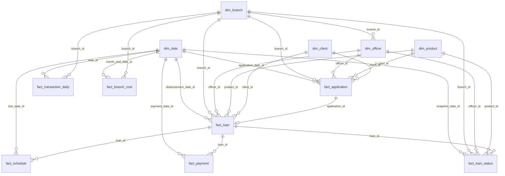

# Data Model

The model follows a **star / constellation** design. Five conformed dimensions are shared by seven fact tables at different grains, so applications, loans, instalments, payments, risk snapshots, transactions and costs can be analysed through the same date, branch, officer, product and client filters.

<!-- TODO: add the Power BI model-view screenshot, then uncomment:

-->

## Entity-relationship diagram

## Fact tables and grain

| Fact | Grain | Main date key | Answers |
|---|---|---|---|
| `fact_application` | Application | `application_date_id` | Demand, approval rate, decline reasons, approved credit score |
| `fact_loan` | Disbursed loan | `disbursement_date_id` | Disbursement volume, ticket size, granted rate, vintage cohort |
| `fact_schedule` | Instalment | `due_date_id` | What the client should pay; contractual interest for portfolio yield |
| `fact_payment` | Payment | `payment_date_id` | What the client actually paid; payment channel |
| `fact_loan_status` → `v_loan_status_clean` | Loan × month-end | `snapshot_date_id` | **Official** portfolio, PAR, provisions, write-offs (always read through the cleaned view) |
| `fact_transaction_daily` | Day × branch × channel | `date_id` | Channel mix, digital share, cash-desk workload |
| `fact_branch_cost` | Branch × month | `month_end_date_id` | Operating cost, headcount |

## Power BI modelling notes

- `dim_date` is **marked as the date table** on `full_date`.
- All relationships are **one-to-many, single-direction** from dimension to fact.
- `fact_application` → `fact_loan` (on `application_id`) is fact-to-fact. In the Power BI model the loan attributes needed for application analysis are brought in through Power Query instead of a fact-to-fact relationship.
- The loan-status table is loaded into Power BI from **`v_loan_status_clean`**, not from the raw `fact_loan_status`. The model table is named `fact_loan_status_clean`. It keeps one row per loan per snapshot and removes the duplicated copies found in the 2026-06-30 snapshot ([details](methodology.md#data-quality-discovery--duplicated-latest-loan-status-snapshot)). If the view is unavailable, Power Query applies the same rule: group by `snapshot_date_id` and `loan_id`, then keep the row with the highest `status_id`.
- `fact_loan_status_clean` has no `client_id`. Power Query merges `client_id` (and `disbursement_date_id` for vintage cohorts) from `fact_loan` on `loan_id`, so Active Clients and vintage measures do not need a fact-to-fact relationship.
- `dim_officer` → `dim_branch` is a snowflake link used for officer counts per branch. Facts relate to `dim_branch` directly.
- Risk measures always resolve to a **single month-end snapshot** in the current filter context (see [DAX measures](../dax/measures.md)), so selecting a year or quarter never sums several snapshots together.

## Why this design

- **Separate grains stay separate.** Applications, loans, instalments, payments and snapshots are different events. Merging them into one wide table would double-count balances.
- **Snapshots are not transactions.** `fact_loan_status` is a periodic snapshot fact: its balances are semi-additive (additive across loans, branches and products, but not across time).
- **Shared dimensions enable cross-domain views.** For example, branch risk (from `fact_loan_status_clean`) can be plotted against branch cost (from `fact_branch_cost`) on one visual, which the Branch Performance page requires.
